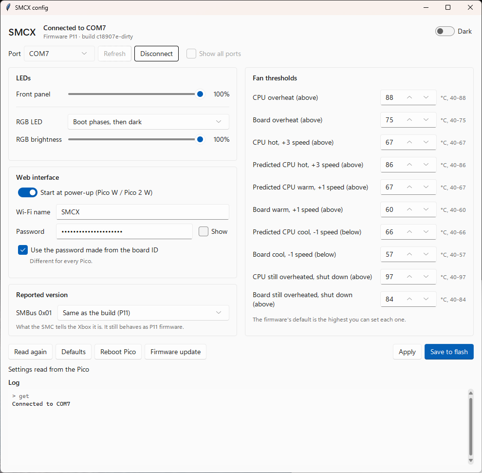

# Original XBOX Pico SMC

Original XBOX SMC implemented with a Rapsberry Pico.

Experimental, currently only confirmed to work on 1.0 boards, it should work for any rev up to 1.4.

## Whats working
- Power ON/OFF
- DVD eject
- LED control
- AV pack detection/override
- Front panel override, you can disable eject and/or power. If you disable power you can power on the xbox with BOOTSEL, this might introduce issues though.
- Fan control (although the fan curve thats used is from 1.2-1.4 units since that one ramps the fans faster, selectable)
- Temperature sensor bypass. Allows you to bypass a broken temperature sensor, it requires a NTC thermistor that you should put as near as possible to the cpu. An offset is offered since you wont be able to get the die temperature. For the board temperature the pico internal temperature sensor is used.
- SMC boot challenge/override
- Version override, since it reports P11 by default most xbox homebrew will report your 1.0/1.1 unit as 1.2/1.3
- Different LED pattern for ram test failures (red blink). Depending on the failure you might still get a regular FRAG.
- Logging and remote control (only power and eject) via UART
- Experimental (optional) WiFi control, requires external power to the pico (the 3.3v standby rail is not strong enough)
- Python GUI to configure the smc, requires python tk and sv-ttk

## Pictures/Screenshots

### Dev board

### Config tool

## Notes
- *Heavily* based on the work Prehistoricman did. [Xbox_SMC](https://github.com/Prehistoricman/Xbox_SMC)
- By default it mimics the P2L SMC behavior, except for the fan control/thermal sensor management and the boot challenge is made optional.
- Some AI assistance was used (claude), mostly for the web interface, documentation and tests.
- For the stock behavior, check the stock_smc branch.
- It uses X-HD Redux as its reference to decode video modes.
- All the new SMC commands are introduced from 0x30 onwards

## Thanks
- Prehistoricman for all the work done on the SMC
- Andr0 for designing the PXU (so I can safely work on this project without getting zapped) and the help with how the psu operates
- Harcroft for all the help with xbox questions
- Team Resurgent
- Cerbios
- To everyone in the xbox-scene community

## Documentation
- [SMBUS commands](/docs/SMBUS.md)
- [State Machines](/docs/StateMachines.md)
- [Wiring](/docs/Wiring.md)
