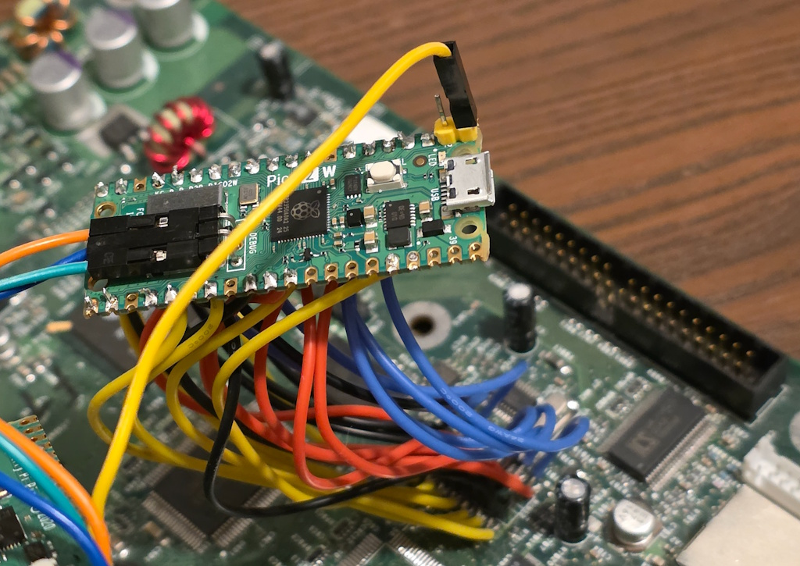

# Original XBOX Pico SMC

Original XBOX SMC implemented with a Rapsberry Pico.

Very very experimental, currently it boots on 1.0 boards (although the fan curve thats used is from 1.2-1.4 units since that one ramps the fans faster).

## Whats working
- Power ON/OFF
- LED control
- AV pack detection/override
- DVD eject
- Fan control
- SMC boot challenge/override
- Version override, since it reports P11 by default most xbox homebrew will report your 1.0/1.1 unit as 1.2/1.3
- Logging via uart
- Experimental WiFi control, requires external power to the pico (the 3.3v standby rail is not strong enough)

## Notes
- *Heavily* based on the work Prehistoricman did. [Xbox_SMC](https://github.com/Prehistoricman/Xbox_SMC)
- By default it mimics the P11 SMC behavior, except the boot challenge is optional.
- Some AI assistance was used (claude), mostly for the web interface and documentation.
- For the stock behavior, check the stock_smc branch.

## Thanks
- Prehistoricman for all the work done on the SMC
- Andr0 for designing the PXU (so I can safely work on this project without getting zapped) and the help with how the psu operates
- Harcroft for all the help with xbox questions
- Team Resurgent
- Cerbios
- To everyone in the xbox-scene community

## Documentation
- [SMBUS commands](/docs/SMBUS.md)
- [State Machines](/docs/StateMachines.md)
- [Wiring](/docs/Wiring.md)
