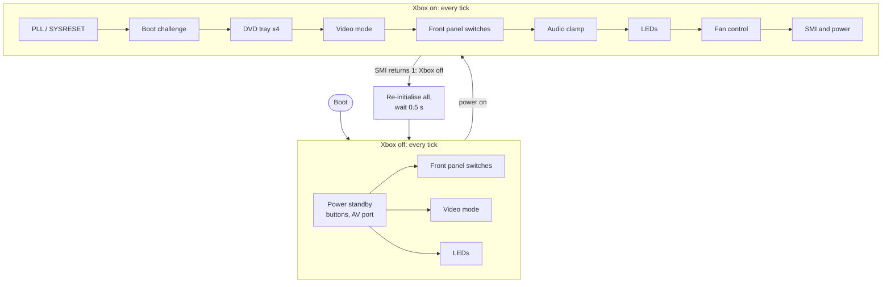

# State machines

The SMC is a set of small state machines, the same ones as the original PIC
firmware. Each runs one step per 20 ms tick from the main loop
(`main_loop()` in `src/smc.cpp`). Where a state name is followed by a hex
address, that's the matching code in the PIC disassembly.

| State machine | File | Runs |
|---------------|------|------|
| [Power standby](state-machines/power_standby.md) | `smc_power_standby.cpp` | Xbox off |
| [SMI and power](state-machines/smi_power.md) | `smc_SMI.cpp` | Xbox on |
| [PLL and SYSRESET](state-machines/pll_reset.md) | `smc_pll_reset.cpp` | Xbox on |
| [Boot challenge](state-machines/boot_challenge.md) | `smc_boot_challenge.cpp` | Xbox on |
| [Fan control](state-machines/fan_control.md) | `smc_fan_pic.cpp`, `smc_fan_p2l.cpp` | Xbox on |
| [DVD tray](state-machines/dvd_tray.md) (4 machines) | `smc_dvd.cpp` | Xbox on |
| [Video mode](state-machines/video.md) | `smc_video.cpp` | Both |
| [Audio clamp](state-machines/audio_clamp.md) | `smc_audio_clamp.cpp` | Xbox on |
| [LEDs](state-machines/leds.md) | `smc_led.cpp` | Both |
| [Front panel switches](state-machines/front_panel_switches.md) | `smc_front_panel_sw.cpp` | Both |

The state machines share their state through `SMC::flags` (`src/smc_types.hpp`),
like the PIC's RAM flags at 0x6C-0x74. The SMBus commands that drive them are
described in [SMBUS.md](../../SMBUS.md).

The diagrams are Mermaid and render on GitHub and in most Markdown viewers.
