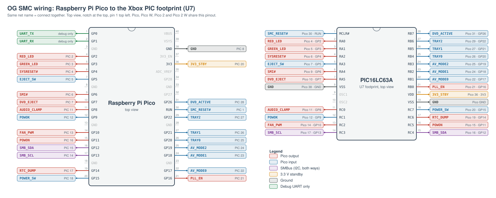

# Wiring

The Pico replaces the Xbox's PIC16LC63A SMC (28-pin, U7). Each signal goes
from a Pico GPIO to the matching pad of the removed PIC. The GPIO numbers come
from `src/pin_assignments.hpp`; the pinout is the same on the Pico, Pico W,
Pico 2 and Pico 2 W.

GPIO0/GPIO1 (Pico pins 1/2) are the debug UART (115200 baud, TX on GPIO0).
Besides the log it takes commands, one per line (`src/serial_console.hpp`):
`power` and `eject` press those buttons (from standby too), `help` lists them.
They work even with the front panel buttons turned off in the settings.
GPIO23-25 are unused: on the W boards they belong to the wireless chip.



Each coloured tag is a net: connect the Pico pin and the PIC pad that carry the
same name. The tag also says where the other end is. The drawing is generated by
`tools/wiring_svg.py` (`python tools/wiring_svg.py docs/images/wiring.svg`).

## Pin table

| PIC pin | PIC port | Signal | Dir. (Pico) | Pico GPIO | Pico pin | Notes |
|--------:|----------|--------|-------------|-----------|---------:|-------|
| 1 | MCLR# | SMC reset | In | RUN | 30 | Resets the Pico together with the board's SMC reset (brown-out) |
| 2 | RA0 | Red LED | Out | GP2 | 4 | Active low, PWM (`SMC_LED_BRIGHTNESS`) |
| 3 | RA1 | Green LED | Out | GP3 | 5 | Active low, PWM |
| 4 | RA2 | SYSRESET# | Out | GP4 | 6 | Low holds the system in reset. 10k pull-up on the board |
| 5 | RA3 | Eject switch | In | GP5 | 7 | Low when pressed. Internal pull-up, 10k on the board |
| 6 | RA4 | SMI# | Out | GP6 | 9 | Idles high, pulsed low (~2 µs). 10k pull-up on the board |
| 7 | RA5 | DVD eject | Out | GP7 | 10 | Open drain: only driven low, released otherwise. 1k pull-up on the board |
| 8 | Vss | Ground | | GND | 38 | Any Pico GND pin |
| 9 | CLKIN | Clock | | | | Not connected |
| 10 | CLKOUT | Clock | | | | Not connected |
| 11 | RC0 | Audio clamp | Out | GP8 | 11 | High = audio muted |
| 12 | RC1 | POWOK | In | GP9 | 12 | High while the PSU is good; a falling edge while on shuts down |
| 13 | RC2 | Fan PWM | Out | GP10 | 14 | ~9.8 kHz PWM, inverted (low = fast) |
| 14 | RC3 | SMBus SCL | I/O | GP13 | 17 | I2C0, slave address 0x10; also bit-banged as master |
| 15 | RC4 | SMBus SDA | I/O | GP12 | 16 | I2C0 |
| 16 | RC5 | POWON | Out | GP11 | 15 | High turns the PSU on |
| 17 | RC6 | RTC dump | Out | GP14 | 19 | High during the RTC dump after boot failures |
| 18 | RC7 | Power switch | In | GP15 | 20 | Low when pressed. Internal pull-up |
| 19 | Vss | Ground | | GND | 38 | |
| 20 | Vdd | 3.3 V standby | Power | 3V3 | 36 | See the power notes below |
| 21 | RB0 | PLL enable | Out | GP16 | 21 | High = PLL on |
| 22 | RB1 | AV mode 0 | In | GP17 | 22 | 10k pull-up to standby on the board, no internal pull |
| 23 | RB2 | AV mode 1 | In | GP18 | 24 | 10k pull-up to POWON on the board |
| 24 | RB3 | AV mode 2 | In | GP19 | 25 | 10k pull-up to standby on the board |
| 25 | RB4 | Tray state 0 | In | GP20 | 26 | From the DVD drive, no internal pull |
| 26 | RB5 | Tray state 1 | In | GP21 | 27 | From the DVD drive, no internal pull |
| 27 | RB6 | Tray state 2 | In | GP22 | 29 | From the DVD drive, no internal pull |
| 28 | RB7 | DVD active | In | GP26 | 31 | Configured as an input; the firmware doesn't read it yet |

Inputs from the AV port and the DVD drive have no internal pull-ups, like the
PIC (its PORTB pull-ups are off). Pulling up the lines of an unpowered drive
would feed it through its pins.

## RGB LED

A WS2812 (NeoPixel) on GP27 (Pico pin 32) shows how far the Xbox got in
booting (`SMC_RGB_LED`, on by default). Wire its data input to GP27, power it
from 3.3 V (or 5 V with a level shifter on the data line) and ground.

Its brightness (1-100 %) is its own, separate from the front panel's, and it
has three modes: `off` (dark, even while booting), `boot` (the phases below,
then dark; the default) and `mirror` (the phases below, then green, red or
orange as the front panel LEDs show). Both are set with the USB config
(`set rgb-mode`, `set rgb-brightness`, saved with `save`), the web interface,
or SMBus 0x36 for the brightness. Software can also show its own colour with
SMBus 0x37-0x3A, see `docs/SMBUS.md`.

| Colour | Phase |
|--------|-------|
| Off | Xbox off |
| Magenta | Powered, held in reset (also after a reset from the dashboard) |
| Blue | Out of reset, BIOS running (waiting for the RAM test) |
| Cyan | RAM test passed, waiting for the kernel (boot challenge answer or SMBus 0x1A) |
| Green, for 5 s | Booted (challenge passed or SMBus 0x1A written), then off (or the front panel in `mirror` mode) |
| Red | The boot challenge gave up (FRAG), or a RAM test failed with no chip flagged |
| Yellow / orange / purple / white | RAM test failed on chip 0 / 1 / 2 / 3 (see SMBus 0x12 in [SMBUS.md](SMBUS.md)). Blinking: chip 4 / 5 / 6 / 7, the second set of a 128 MB board. Several chips: their colours in turn, 1 s each |

`RGB:` lines at DEBUG level log each change.

## Extra temperature sensors

These are not on the PIC. They're read once a second, and show up on SMBus
(0x31 Pico, 0x32 NTC, see `docs/SMBUS.md`), in the log (`TEMP:` lines at DEBUG
level) and in the web interface.

- **Pico temperature:** the RP2040/RP2350's own sensor, always read. It
  measures the chip, so it reads a few degrees above the air around it.
- **NTC thermistor (optional, the NTC setting):** on GP28 (ADC2, Pico pin
  34), wired as a divider:

  ```
  3V3 ── series resistor ──┬── GP28
                           └── NTC ── GND (pin 33, AGND)
  ```

  Turn it on, and set the parts' values, in the config GUI's NTC thermistor card
  or with the USB config (`set ntc on`, `set ntc-beta`, `set ntc-r25`,
  `set ntc-series`). Defaults: off, 10k NTC with beta 3950, 10k series
  resistor; `-DSMC_NTC_SENSOR=ON`, `SMC_NTC_BETA`, `SMC_NTC_R25` and
  `SMC_NTC_SERIES_R` change those defaults. With a bad ADM1032 the sensor
  bypass takes the CPU temperature from the NTC instead (place it on or
  near the CPU heatsink), see `docs/state-machines/fan_control.md`. A reading at either end
  of the ADC range (open or shorted NTC) shows as not connected.

## Power

- The PIC runs from the 3.3 V standby rail (pin 20). Wired to the Pico's 3V3
  pin, it powers the Pico whenever the Xbox is plugged in.
- The standby rail is not strong enough for Wi-Fi: the Pico W / Pico 2 W need
  external power if you use the web functionality (built in on the W
  boards, then turned on with `set web on`).
- Use a single supply for the Pico. If it's powered over USB or VSYS, the
  standby rail and the Pico's own 3.3 V regulator both drive the 3V3 net; leave
  pin 20 unconnected (or disable the regulator) in that case. All grounds must
  be connected.
- All Xbox-side signals are 3.3 V, the same as the Pico's GPIOs.

## Notes

- An SWD debug probe masks if the pico browns out, which happens if you use
  the 3.3v standby rail form the xbox for WiFi.
- On the RP2350 (Pico 2 / 2 W) the button inputs only have their input buffers
  on while being read, to work around erratum E9 (`readWeakInput()` in
  `src/hal.cpp`).
