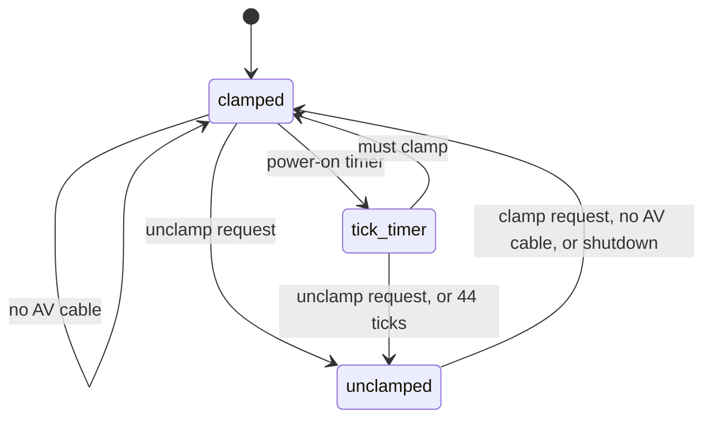

# Audio clamp

`src/smc_audio_clamp.cpp`, PIC 0x573. Mutes (clamps) the audio output.

The audio is always clamped without an AV cable or during shutdown. At power on
it unclamps after 44 ticks (~0.9 s). SMBus 0x0B clamps (1) or unclamps (0).

| # | State | What it does |
|---|-------|--------------|
| 0 | `clamped` | Clamp on, clears the clamp request, restarts the 44-tick delay |
| 1 | `tick_timer` | Counts down the power-on delay |
| 2 | `unclamped` | Clamp off, clears the unclamp request |
