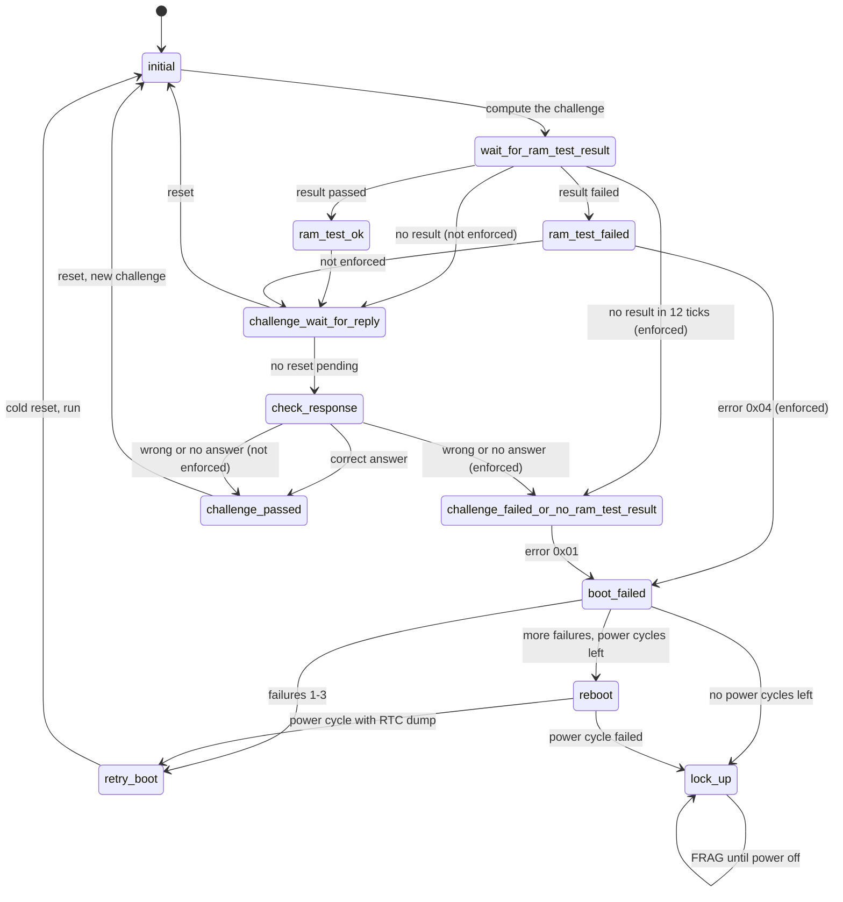

# Boot challenge

`src/smc_boot_challenge.cpp`, PIC 0x8C5. Checks the BIOS RAM test result
(SMBus 0x12/0x13) and the answer to the boot challenge (SMBus 0x1C-0x21) after
every reset.

By default (`SMC_BOOT_CHALLENGE=OFF`) failures are only logged: the dashed
paths below are taken instead of the failure handling. With
`SMC_BOOT_CHALLENGE=ON` the SMC resets, power cycles and finally locks up
(FRAG) like the original.

The debug kit firmwares differ (`SMC_FIRMWARE=D01` or `DXF`):

- **D01 and DXF** have no challenge. The challenge bytes are never filled in
  and nothing is computed; after the RAM test, `challenge_wait_for_reply` only
  waits for the next reset, so `check_response` and `challenge_passed` are never
  reached. `SMC_BOOT_CHALLENGE=ON` then only enforces the RAM test.
- **DXF** doesn't power cycle after repeated failures: `boot_failed` goes to
  `rtc_dump_start`, then `reboot` holds RTC dump high for 100 ticks (2 s) while
  the system is held in reset, and the boot is retried.

Every firmware does these as P2L (v1.6): `initial` restarts the tray tracking,
a boot failure mutes the audio, and FRAG only lets the eject button open the
tray when the Xbox isn't overheated.

P2L also follows P11 with these changes: it waits 15 ticks for the RAM test,
`initial` also lets the system run, the answer is only checked after a passed
RAM test and then it goes back to `challenge_wait_for_reply`
(`challenge_passed` is never used), and every reset makes a new challenge and
resets the power cycle countdown.

| # | State | What it does |
|---|-------|--------------|
| 0 | `initial` | Computes the expected answer, starts a 12-tick timeout |
| 1 | `wait_for_ram_test_result` | Waits for SMBus 0x12 |
| 2 | `ram_test_ok` | Logs the result |
| 3 | `ram_test_failed` | Logs it. Enforced: LED pattern, error code 0x04 |
| 4 | `challenge_failed_or_no_ram_test_result` | LED pattern, error code 0x01 |
| 5 | `challenge_wait_for_reply` | Starts the 4-tick answer timeout (as P11, P01 waits 2) unless a reset is pending |
| 6 | `boot_failed` | Counts failures: the first 3 reset the Xbox, then up to 3 power cycles, then FRAG |
| 7 | `lock_up` | FRAG: shows the error LEDs, holds the system in reset; the power button turns off right away and the eject button opens the tray |
| 8 | `retry_boot` | Cold reset and run again |
| 9 | `check_response` | Compares SMBus 0x20/0x21 with the expected answer |
| 10 | `challenge_passed` | Waits for the next reset, then starts a new challenge |
| 11 | `reboot` | After 4 ticks, powers the Xbox off, pulses RTC dump for 100 ticks (2 s) and powers it on again. Blocks the main loop while it runs. DXF: RTC dump for 100 ticks without a power cycle, one tick per step |
| 12 | `rtc_dump_start` | DXF only: one tick before `reboot` |
