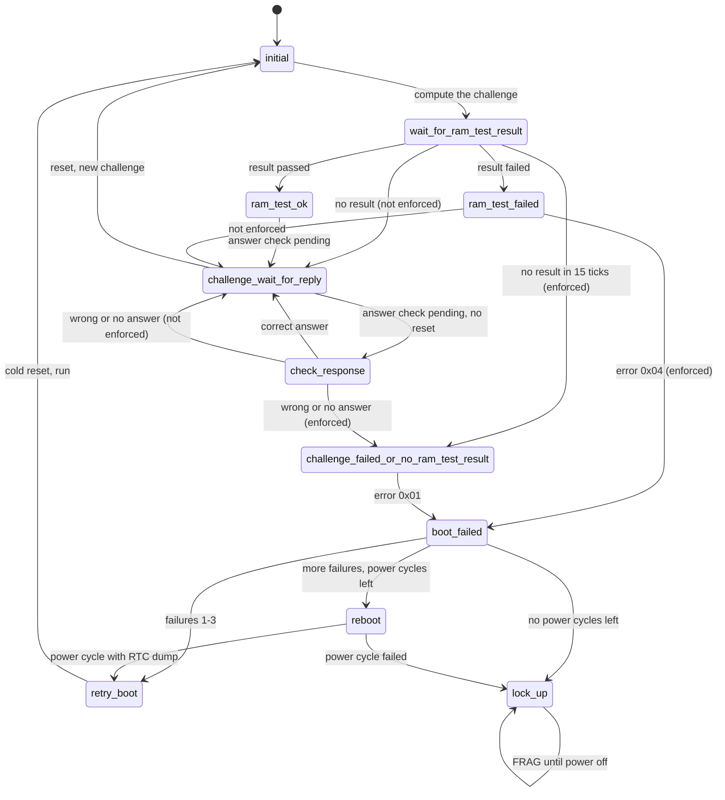

# Boot challenge

`src/smc_boot_challenge.cpp`, PIC 0x8C5. Checks the BIOS RAM test result
(SMBus 0x12/0x13) and the answer to the boot challenge (SMBus 0x1C-0x21) after
every reset.

By default failures are only logged: the dashed paths below are taken
instead of the failure handling. Enforced (the `boot-challenge` setting, USB
config or the config GUI; `SMC_BOOT_CHALLENGE=ON` makes it the default) the SMC
resets, power cycles and finally locks up (FRAG) like the original.

Every firmware follows P2L (v1.6). Compared with the PIC (P01/P11):

- `initial` waits 15 ticks for the RAM test (the PIC waits 12), lets the
  system run and restarts the tray tracking.
- The answer is only checked once, after a passed RAM test (4-tick timeout).
  Then it goes back to `challenge_wait_for_reply` to wait for the next reset;
  the PIC's separate "challenge passed" state is gone.
- Every reset makes a new challenge and resets the power cycle countdown.
- A failed RAM test shows blinking red LEDs (the PIC: red/orange), also when
  the challenge isn't enforced.
- A boot failure mutes the audio, and FRAG only lets the eject button open the
  tray when the Xbox isn't overheated.

The debug kit firmwares differ (`SMC_FIRMWARE=D01` or `DXF`):

- **D01 and DXF** have no challenge. The challenge bytes are never filled in
  and nothing is computed, and a passed RAM test doesn't lead to
  `check_response`. Enforcing it then only enforces the RAM test.
- **DXF** doesn't power cycle after repeated failures: `boot_failed` goes to
  `rtc_dump_start`, then `reboot` holds RTC dump high for 100 ticks (2 s) while
  the system is held in reset, and the boot is retried.

| # | State | What it does |
|---|-------|--------------|
| 0 | `initial` | Computes the expected answer, starts a 15-tick timeout, lets the system run, restarts the tray tracking |
| 1 | `wait_for_ram_test_result` | Waits for SMBus 0x12 |
| 2 | `ram_test_ok` | Logs the result, marks the answer to be checked |
| 3 | `ram_test_failed` | Logs it and shows blinking red LEDs until a RAM test passes or power off, enforced or not (the PIC shows red/orange, only when enforced). Enforced: error code 0x04 |
| 4 | `challenge_failed_or_no_ram_test_result` | Red/green LED pattern, error code 0x01 |
| 5 | `challenge_wait_for_reply` | On a reset: new challenge, power cycle countdown back to 3. Otherwise, if the answer is still to be checked, starts the 4-tick answer timeout |
| 6 | `boot_failed` | Mutes the audio and counts failures: the first 3 reset the Xbox, then up to 3 power cycles, then FRAG |
| 7 | `lock_up` | FRAG: shows the error LEDs, holds the system in reset; the power button turns off right away and the eject button opens the tray unless overheated |
| 8 | `retry_boot` | Cold reset and run again |
| 9 | `check_response` | Compares SMBus 0x20/0x21 with the expected answer |
| 10 | `reboot` | After 4 ticks, powers the Xbox off, pulses RTC dump for 100 ticks (2 s) and powers it on again. Blocks the main loop while it runs. DXF: RTC dump for 100 ticks without a power cycle, one tick per step |
| 11 | `rtc_dump_start` | DXF only: one tick before `reboot` |
