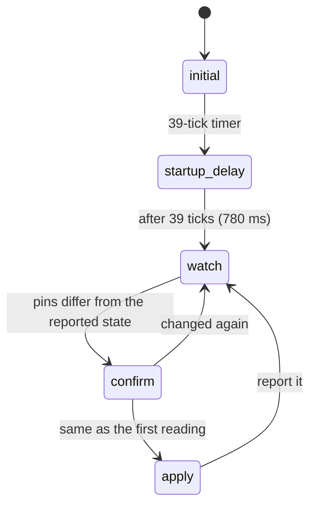
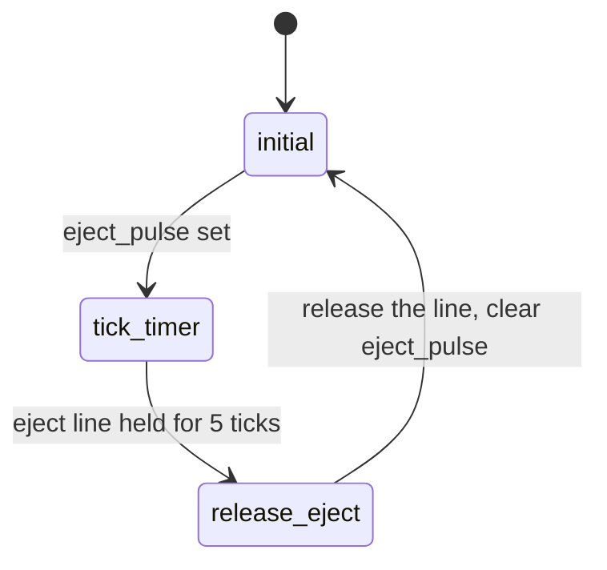
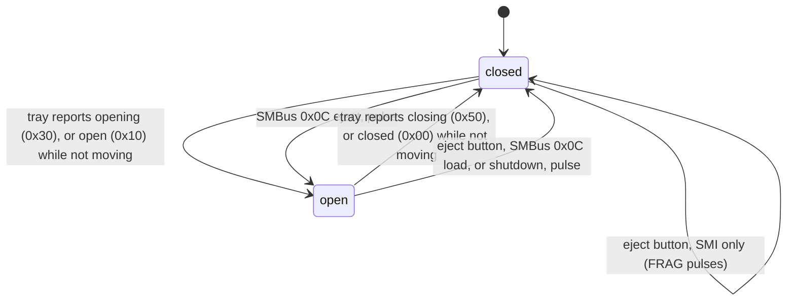
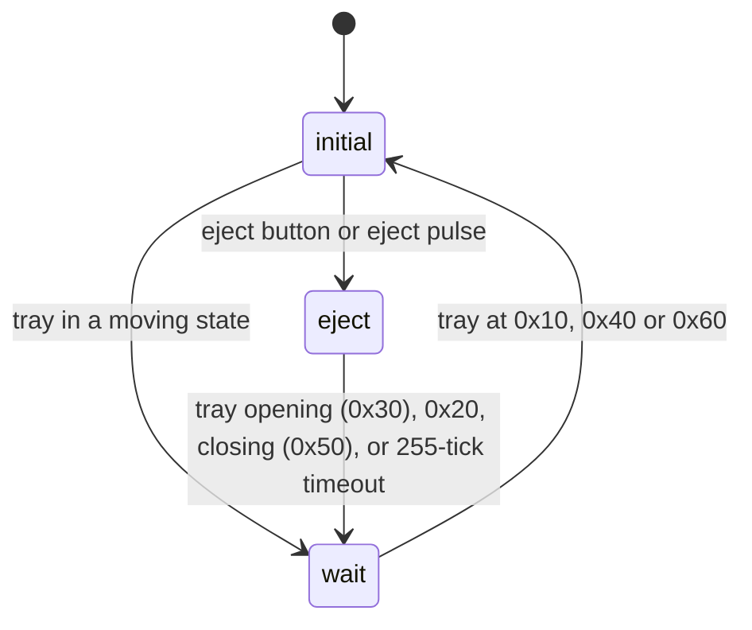

# DVD tray

`src/smc_dvd.cpp`. Four small state machines handle the DVD drive. With "No DVD
drive" on (`set no-dvd on` in the USB config, or the config GUI; off by
default, `SMC_NO_DVD=ON` makes on the default) they don't run, and the
tray is reported closed and empty (0x40). Every build has them.

Tray states (SMBus 0x03): 0x00 closed, 0x10 open, 0x20 unloading, 0x30 opening,
0x40 no disc, 0x50 closing, 0x60 disc detected, 0x70 drive off.

## Tray state debounce (`tray_debounce_state`, PIC 0x9D3)

Reads the drive's tray state pins and reports a new state after two equal
readings. Raises the tray SMIs.

| State | What it does |
|-------|--------------|
| `initial` | Starts the start-up delay |
| `startup_delay` | Ignores the tray after power on and when the boot challenge starts. A warm reset also comes back here, then for ~5 s |
| `watch` | Waits for the pins to differ from the reported state |
| `confirm` | Reads again |
| `apply` | Reports the state and, once tray events are enabled, raises an SMI: 0x30 opening, 0x00 closed, 0x40/0x60 media. Any other state enables tray events |

## Eject pulse (`eject_pulse_state`, PIC 0xADE)

## Open / close decision (`updateEjectRequests`, PIC 0x4D0)

Two states, tracking whether the tray was last sent open or closed. It starts as
closed.

While the tray is open the SMC closes it on its own. While it's closed the eject
button only raises an SMI, and the OS opens the tray with SMBus 0x0C. Pulses
are skipped while the drive reports 0x70 or 0x20.

The DVD handling follows P2L (v1.6) for every firmware. Compared with the PIC:

- A tray that isn't moving and reports 0x00 or 0x10 also counts as closed or
  open, except right after an eject press or pulse.
- Every eject pulse, not only the eject button, starts the tray moving tracking.
- A closing tray (0x50) always ends the eject phase of the tray moving tracking.
- The debounce start-up delay is 39 ticks instead of 32, and the boot challenge
  start restarts the debounce and the tray moving tracking.
- The DXF stop at 0x00 in the tray moving tracking is gone.

## Tray moving (`tray_moving_state`, PIC 0x519)

Sets `tray_moving`, reported in SMBus 0x03 bit 0 and shown as a quick green blink.

| State | What it does |
|-------|--------------|
| `initial` | Not moving |
| `wait` | Moving, until the tray settles |
| `eject` | Moving after an eject button press or pulse, until the drive reacts |
