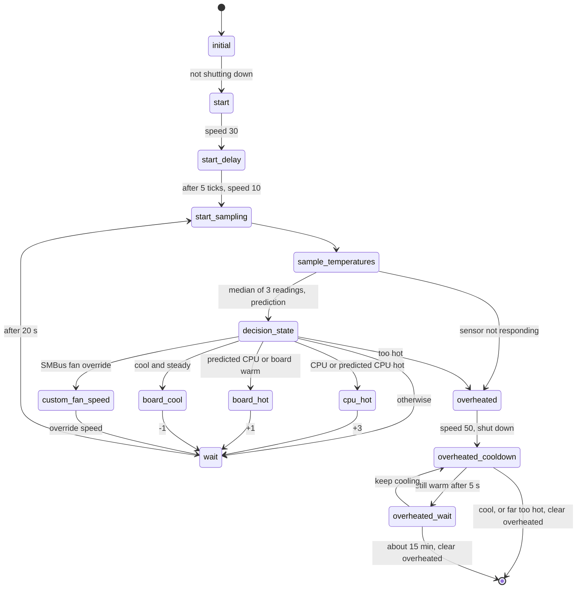

# Fan control

`src/smc_fan.cpp`, PIC 0x36F. Reads the temperature sensor, predicts the CPU
temperature and adjusts the fan speed (10-50) every 20 s. Detects overheating.

Thresholds (°C) differ between firmwares:

| Threshold | P01 | P11 |
|-----------|-----|-----|
| CPU hot (+3) | 74 | 67 |
| Predicted CPU warm (+1) | 74 | 67 |
| Predicted CPU cool (-1) | 73 | 66 |
| Predicted CPU hot (+3) | 86 | 86 |
| Board warm (+1) / cool (-1) | 60 / 57 | 60 / 57 |
| Overheat CPU / board | 88 / 75 | 88 / 75 |
| Give up cooling CPU / board | 97 / 84 | 97 / 84 |

| # | State | What it does |
|---|-------|--------------|
| 0 | `initial` | Minimum speed, clears `overheated` |
| 1 | `start` | Speed 30 for 5 ticks after power on |
| 2 | `decision_state` | Picks the next step from the readings, highest priority first |
| 3 | `overheated` | Speed 50, requests a cold reset and holds the system in reset, sets `overheated` |
| 4 | `overheated_cooldown` | Every 250 ticks (5 s) reads the sensor. Clears `overheated` once cool, or when it's far too hot |
| 5 | `overheated_wait` | Counts up to 179 cooling rounds (~15 min), then clears `overheated` |
| 6 | `custom_fan_speed` | Speed from SMBus 0x06 |
| 7 | `board_cool` | Speed -1 |
| 8 | `board_hot` | Speed +1 |
| 9 | `wait` | 50 × 20 ticks (20 s). Keeps applying the override speed |
| 10 | `start_delay` | Waits the 5 start ticks, then speed 10 |
| 11 | `sample_temperatures` | One reading per tick, 3 in all. A failed reading is retried for 20 ticks, then the bus is recovered once (not on DXF); if the sensor still doesn't answer the SMC forces an overheat |
| 12 | `cpu_hot` | Speed +3 |
| 13 | `start_sampling` | Starts a set of 3 readings |

Clearing `overheated` lets the SMI state machine finish the shutdown it started
in `overheat_cooldown_wait`.
