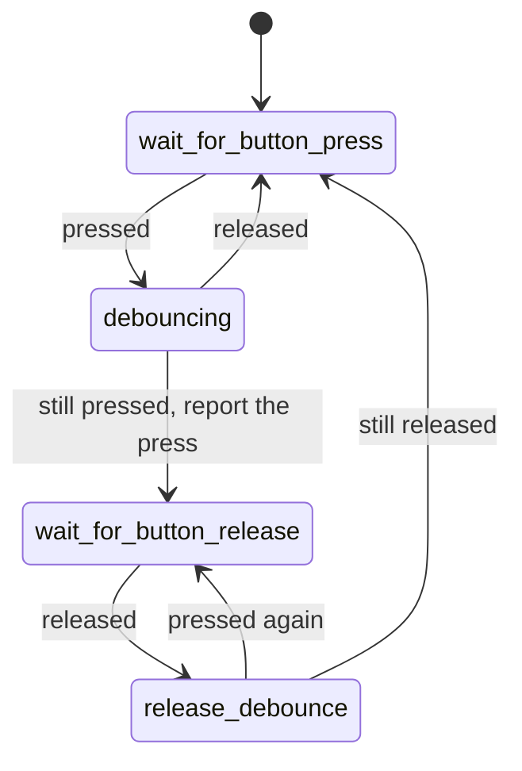

# Front panel switches

`src/smc_front_panel_sw.cpp`, PIC 0x800 (power) and 0x828 (eject). Debounces the
power and eject buttons. Both use the same four states and run once per tick.

| State | What it does |
|-------|--------------|
| `wait_for_button_press` | Waits for a press |
| `debouncing` | A press counts once it's seen on two ticks in a row |
| `wait_for_button_release` | Waits for the release, so holding the button counts once |
| `release_debounce` | A release counts once it's seen on two ticks in a row |

A power button press sets `power_change_requested`. An eject button press sets
`eject_change_requested` and `eject_button_event`.

The buttons are interlocked, as in P2L (v1.6), for every firmware: a power
press only counts while the eject button's state machine is idle, and the other
way round. P01/P11 count both.

The buttons are read with the pad input enabled only while reading (RP2350
erratum E9, see `readButton()` in `src/hal.cpp`).
