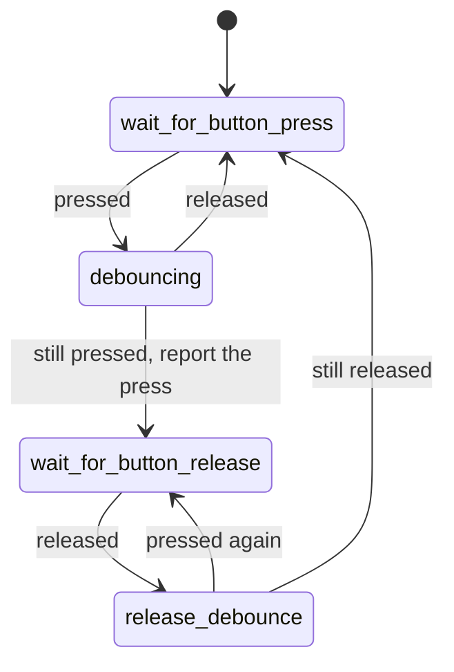

# Front panel switches

`src/smc_front_panel_sw.cpp`, PIC 0x800 (power) and 0x828 (eject). Debounces the
power and eject buttons, once per tick.

## Turning the buttons off

Saved settings (USB config or the config GUI's Front panel card), all on by default
except BOOTSEL (`SMC_BOOTSEL_POWER` in `src/config.hpp`, off):

- **Power button off:** its line is ignored, and the Pico's own BOOTSEL
  button is the power button instead, for powering on from standby and for
  the power SMI while running. BOOTSEL can't be turned off then
  (`set bootsel-power off` is refused).
- **BOOTSEL as a power button** can also be on with the power button: either
  one works.
- **Eject button off:** its line is ignored; the tray only moves when the OS
  asks (SMBus 0x0C). It doesn't hold up the power button either (the
  interlock below only waits for a button that's read).

BOOTSEL goes through the same debouncer. It's read through the flash chip's
select line, so each read pauses the other core and the interrupts for about
50 µs (`hal::bootsel_button_pressed()`, `src/hal_bootsel.cpp`); it's only read
while it's a power button. Holding BOOTSEL while the Pico itself restarts (a
watchdog reset, a reboot from the USB config) starts its USB bootloader
instead of the SMC, as always.

Each button has a `Debouncer` with two booleans: `pressed` (the debounced
level) and `last_raw` (the previous reading). The level only changes when two
readings in a row agree, and `update()` returns true on the tick a press is
confirmed. Together the two booleans are the PIC's four states:

| State | `pressed` | `last_raw` | What it does |
|-------|-----------|------------|--------------|
| `wait_for_button_press` | false | false | Waits for a press (`idle()`) |
| `debouncing` | false | true | A press counts once it's seen on two ticks in a row |
| `wait_for_button_release` | true | true | Waits for the release, so holding the button counts once |
| `release_debounce` | true | false | A release counts once it's seen on two ticks in a row |

A power button press sets `power_change_requested`. An eject button press sets
`eject_change_requested` and `eject_button_event`.

The buttons are interlocked, as in P2L (v1.6), for every firmware: a power
press only counts while the eject button is idle, and the other way round.
P01/P11 count both.

The buttons are read with the pad input enabled only while reading (RP2350
erratum E9, see `readWeakInput()` in `src/hal.cpp`).
