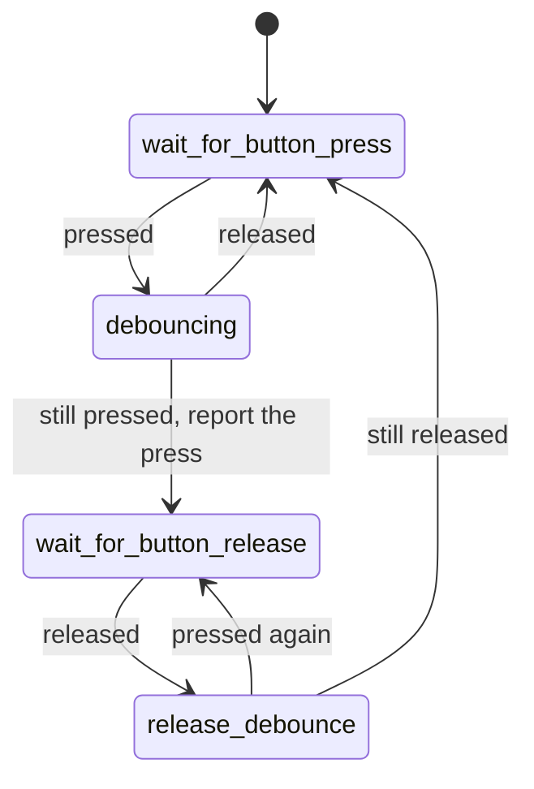

# Front panel switches

`src/smc_front_panel_sw.cpp`, PIC 0x800 (power) and 0x828 (eject). Debounces the
power and eject buttons, once per tick.

Each button has a `Debouncer` with two booleans: `pressed` (the debounced
level) and `last_raw` (the previous reading). The level only changes when two
readings in a row agree, and `update()` returns true on the tick a press is
confirmed. Together the two booleans are the PIC's four states:

| State | `pressed` | `last_raw` | What it does |
|-------|-----------|------------|--------------|
| `wait_for_button_press` | false | false | Waits for a press (`idle()`) |
| `debouncing` | false | true | A press counts once it's seen on two ticks in a row |
| `wait_for_button_release` | true | true | Waits for the release, so holding the button counts once |
| `release_debounce` | true | false | A release counts once it's seen on two ticks in a row |

A power button press sets `power_change_requested`. An eject button press sets
`eject_change_requested` and `eject_button_event`.

The buttons are interlocked, as in P2L (v1.6), for every firmware: a power
press only counts while the eject button is idle, and the other way round.
P01/P11 count both.

The buttons are read with the pad input enabled only while reading (RP2350
erratum E9, see `readWeakInput()` in `src/hal.cpp`).
