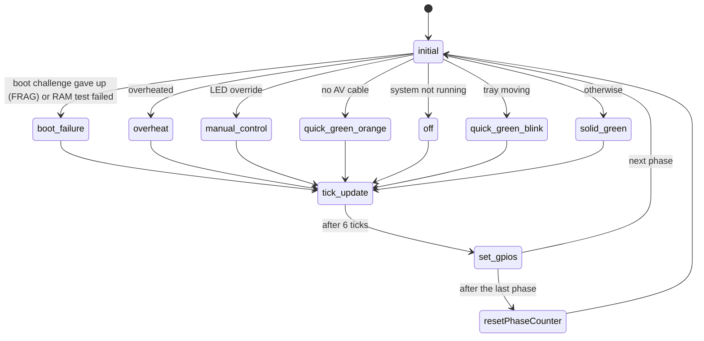

# Front panel LEDs

`src/smc_led.cpp`, PIC 0xA28. Picks the LED pattern and steps through it.

A pattern is a 4-bit value per colour; each bit is one phase of about 180 ms,
shown bit 3 first. Both LEDs on make orange.

| # | State | Red | Green | Result |
|---|-------|-----|-------|--------|
| 1 | `overheat` | 0x3 | 0x3 | Slow orange blink |
| 2 | `manual_control` | SMBus 0x08 | SMBus 0x08 | Pattern from the OS or the boot challenge |
| 3 | `quick_green_blink` | 0x0 | 0x5 | Quick green blink (tray moving) |
| 4 | `solid_green` | 0x0 | 0xF | Green |
| 5 | `off` | 0x0 | 0x0 | Off |
| 9 | `quick_green_orange` | 0x5 | 0xF | Alternating green / orange (no AV cable) |
| 10 | `boot_failure` | 0xA | 0x0 / 0x5 | Boot failure error code: RAM test failed (blinking red, 0x0, until a RAM test passes or power off, also when the boot challenge isn't enforced; the PIC shows red/orange, red 0xF green 0x5, only when enforced) or challenge failed / no RAM test result (red/green, 0x5) |

| # | State | What it does |
|---|-------|--------------|
| 0 | `initial` | Picks the pattern, highest priority first. The boot failure code beats everything (the PIC shows it through the LED override, below an overheat). A missing AV cable beats the LED override on every firmware; the original P11 checks the override first, so a dashboard's LED colours hid it. The override beats the off state, as P11/P2L (P01 checks off first) |
| 6 | `tick_update` | Holds the current phase for 6 ticks |
| 7 | `set_gpios` | Sets both LEDs for the next phase |
| 8 | `resetPhaseCounter` | Starts again at phase 3 |

The LEDs are PWM driven: `SMC_LED_BRIGHTNESS` sets the brightness at start-up,
and the web interface (Pico 2 W) can change it (1-100 %) until the Pico
restarts.

Unlike the PIC, which switches them on and off, the LEDs fade (squared so it
looks even). On by default, `SMC_LED_FADE=OFF` switches them like the PIC:

- **Power up:** when the system starts running, the pattern fades in from dark
  over about 1 s (50 ticks).
- **Power down:** when it stops running, `off` keeps showing the last pattern
  while it fades out over about 0.5 s (25 ticks), then switches the LEDs off
  and restores full brightness for whatever comes next. `clearPhases()` (SMI
  `leds_off`) leaves the fade to finish, and SMI `delayed_turning_off` waits
  for it before cutting the power. Once faded out the LEDs stay dark until the
  power is off, whatever wins over `off` (such as the dashboard's SMBus LED
  override), so they don't light up again while the tray closes.

Powering up again during a fade out (or down during a fade in) continues from
the current level.
