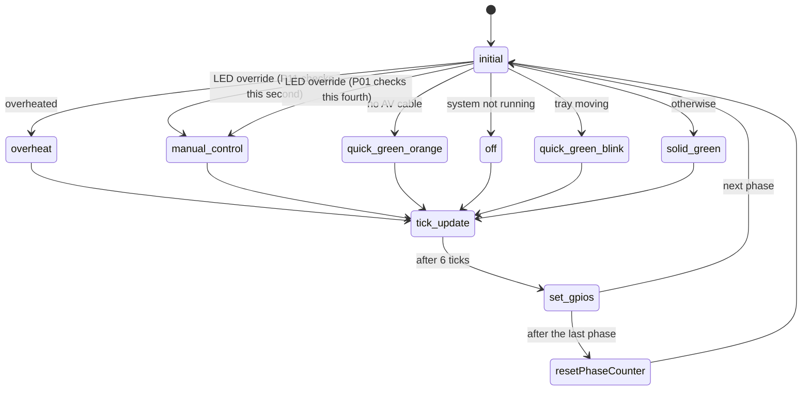

# Front panel LEDs

`src/smc_led.cpp`, PIC 0xA28. Picks the LED pattern and steps through it.

A pattern is a 4-bit value per colour; each bit is one phase of about 180 ms,
shown bit 3 first. Both LEDs on make orange.

| # | State | Red | Green | Result |
|---|-------|-----|-------|--------|
| 1 | `overheat` | 0x3 | 0x3 | Slow orange blink |
| 2 | `manual_control` | SMBus 0x08 | SMBus 0x08 | Pattern from the OS or the boot challenge |
| 3 | `quick_green_blink` | 0x0 | 0x5 | Quick green blink (tray moving) |
| 4 | `solid_green` | 0x0 | 0xF | Green |
| 5 | `off` | 0x0 | 0x0 | Off |
| 9 | `quick_green_orange` | 0x5 | 0xF | Alternating green / orange (no AV cable) |

| # | State | What it does |
|---|-------|--------------|
| 0 | `initial` | Picks the pattern, highest priority first |
| 6 | `tick_update` | Holds the current phase for 6 ticks |
| 7 | `set_gpios` | Sets both LEDs for the next phase |
| 8 | `resetPhaseCounter` | Starts again at phase 3 |

The LEDs are PWM driven: `SMC_LED_BRIGHTNESS` sets the brightness and
`SMC_LED_RED_BREATHE` makes the red LED breathe.
