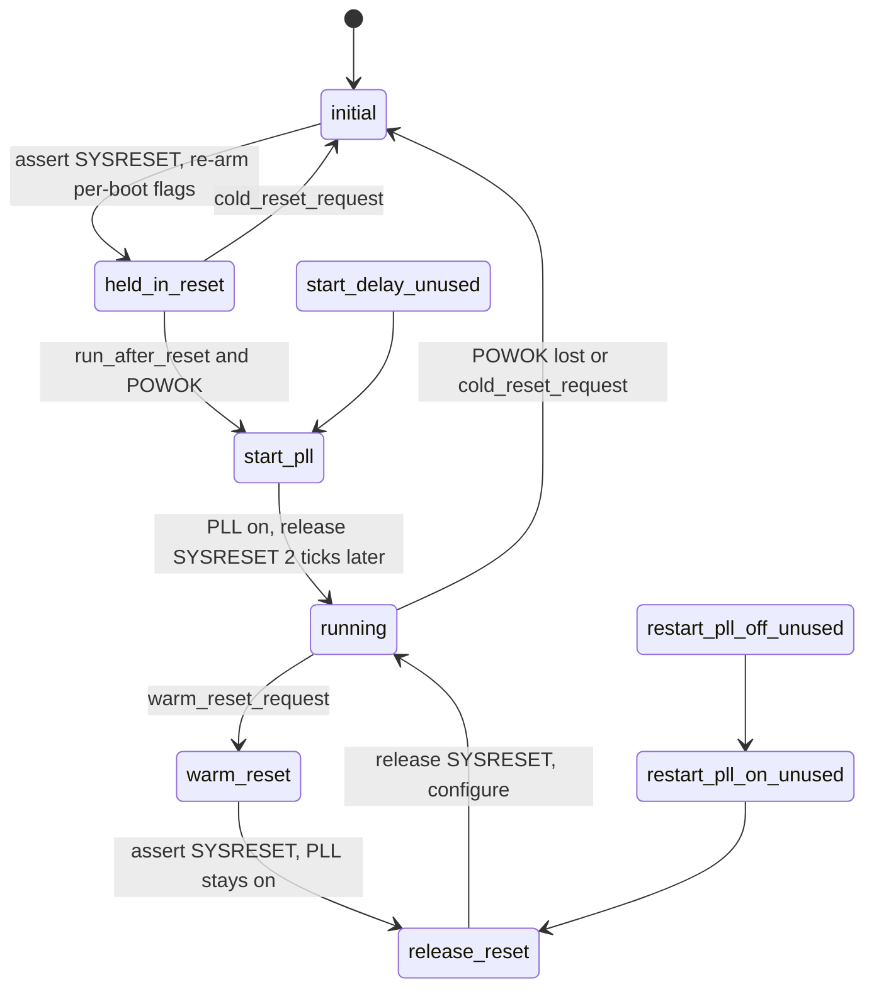

# PLL and SYSRESET

`src/smc_pll_reset.cpp`, PIC 0x5AF. Turns the system PLL on and off and drives
SYSRESET: holds the Xbox in reset until it may run, releases it after a cold
start, and runs warm resets.

| # | State | What it does |
|---|-------|--------------|
| 0 | `initial` | Asserts SYSRESET; clears `cold_reset_request`, `os_ready` and the LED override; turns reset-on-eject off and lets SMBus 0x19 change it again |
| 1 | `held_in_reset` | PLL off. Waits for `run_after_reset` and POWOK. A FRAG keeps `run_after_reset` clear, so the Xbox stays here |
| 2 | `start_delay_unused` | Never entered: state 1 always goes to 3 |
| 3 | `start_pll` | Cold start: PLL on, SYSRESET released 2 ticks later |
| 4 | `release_reset` | Releases SYSRESET, then configures the video encoder (P01: Conexant register 0xBA = 0x3F, after ~1 ms) or the temperature sensor (P11: ADM1032 register 0x09 = 0x00, after ~3 ms) |
| 5 | `warm_reset` | SMBus or OS reset: asserts SYSRESET with the PLL on, same flags as `initial`. P11 also pauses the tray debounce for ~5 s if the tray isn't moving |
| 6 | `restart_pll_off_unused` | Never entered: PLL off and SYSRESET, then 7 |
| 7 | `restart_pll_on_unused` | Only reachable from 6: PLL on, then 4 |
| 8 | `running` | Waits for power loss, a cold reset or a warm reset |

`isHeldInReset()` lets the SMI power-off sequence turn the PSU off as soon as
the system is held in reset.
