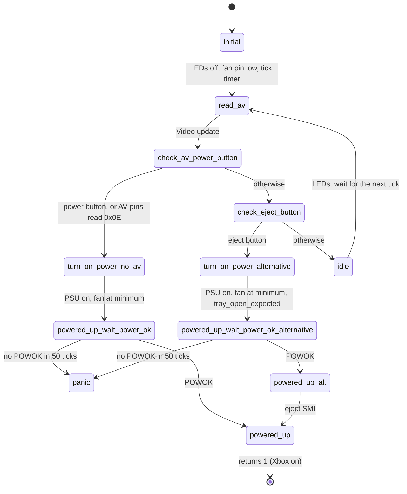

# Power standby

`src/smc_power_standby.cpp`, PIC 0x2AB. Runs while the Xbox is off: watches the
power and eject buttons and the AV port, and powers the Xbox on. `update()`
returns 1 once the Xbox is on, and the main loop switches to the powered loop.

| # | State | What it does |
|---|-------|--------------|
| 0 | `initial` | LEDs off, fan pin at its off level, start the 20 ms tick, tray and AV mode reset |
| 1 | `read_av` | Runs the video state machine once |
| 2 | `check_av_power_button` | Runs the power button debounce. Powers on for the power button, or when the AV mode pins read 0x0E |
| 3 | `turn_on_power_no_av` | PSU on, fan at minimum speed |
| 4 | `powered_up_wait_power_ok` | Waits for POWOK, up to 50 ticks (1 s); without it the SMC panics and the watchdog reboots it |
| 5 | `check_eject_button` | Runs the eject button debounce |
| 6 | `idle` | Updates the LEDs and steps the Pico onboard LED breathe (4 s, Pico and Pico 2 only; solid once the Xbox is on), waits for the next tick, back to `read_av` |
| 7 | `turn_on_power_alternative` | Same as 3, for the eject button: also marks that the tray is expected to open |
| 8 | `powered_up_wait_power_ok_alternative` | Same as 4 |
| 9 | `powered_up_alt` | Sends the eject SMI (`InterruptReason_eject_sw_pressed`) so the OS opens the tray |
| 10 | `powered_up` | Sets up the powered state: `run_after_reset`, `first_execution`, audio clamp timer; resets the video and tray debounce, arms the POWOK interrupt. Returns 1 |

After the Xbox turns off, the main loop re-initialises every state machine and
waits 25 ticks (none after a power cycle, as P2L) before going back to
`initial`.
