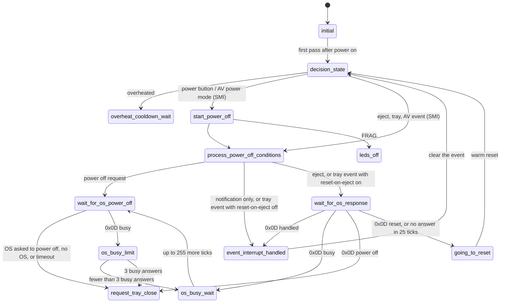
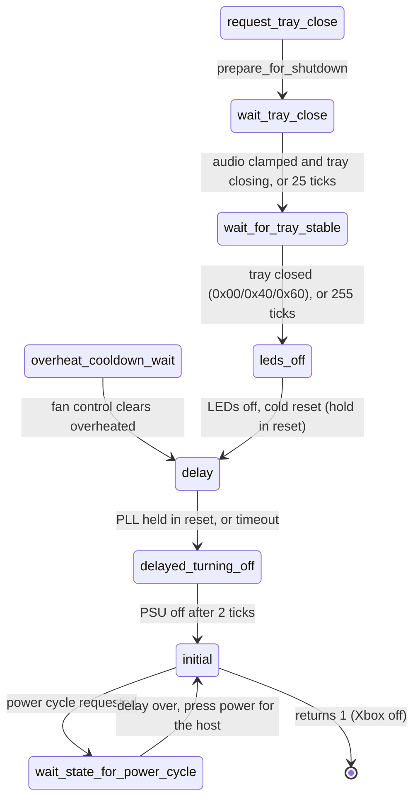

# SMI and power

`src/smc_SMI.cpp`, PIC 0x64E. Runs while the Xbox is on. Raises SMIs (System
Management Interrupts) to the OS for buttons, tray and AV events, waits for the
OS's answer over SMBus 0x0D, and runs the power-off sequence. `update()` returns
1 once the Xbox is off.

The state starts and ends at `initial` (9).

## Events and answers

## Power off

| # | State | What it does |
|---|-------|--------------|
| 0 | `decision_state` | Marks the system running and checks for events, highest priority first: overheat, power button, eject button, AV power mode, tray opening, tray media, tray closed, AV mode change, AV unplugged. Raises the SMI for the event |
| 1 | `start_power_off` | System no longer running. On a FRAG the power button turns off right away |
| 2 | `process_power_off_conditions` | Starts the timeouts (25 ticks, 3 busy answers) and picks the path for the event |
| 3 | `wait_for_os_power_off` | Lets the OS shut down. Without a passed RAM test or SMBus 0x1A there is no OS to ask, so it powers off right away |
| 4 | `event_interrupt_handled` | Clears the event that was signalled and the OS answer, back to 0 |
| 5 | `os_busy_wait` | OS answered "busy": up to 255 more ticks, back to 3 |
| 6 | `request_tray_close` | Sets `prepare_for_shutdown`: the tray closes, the audio clamps |
| 7 | `leds_off` | LEDs off, cold reset with the system held in reset |
| 8 | `wait_tray_close` | Waits for the audio clamp and the tray, up to 25 ticks |
| 9 | `initial` | Clears the events. Powers back on after a power cycle, continues if the Xbox just powered on, otherwise returns 1 |
| 10 | `overheat_cooldown_wait` | Waits for the fan control to finish cooling down |
| 11 | `wait_for_os_response` | Waits for the OS answer to an eject or tray SMI, 25 ticks |
| 12 | `going_to_reset` | Requests a warm reset |
| 13 | `os_busy_limit` | Allows "busy" at most 3 times |
| 14 | `delay` | Waits for the PLL state machine to hold the system in reset, then stops watching POWOK |
| 15 | `wait_for_tray_stable` | Waits for a closed tray state, up to 255 ticks |
| 16 | `delayed_turning_off` | PSU off after 2 ticks |
| 17 | `wait_state_for_power_cycle` | Waits the power cycle delay (SMBus 0x22 minus 2, 23 ticks by default), then the main loop presses the power button |

See [SMBUS.md](../../SMBUS.md) for 0x0D, 0x19 and 0x1A.
