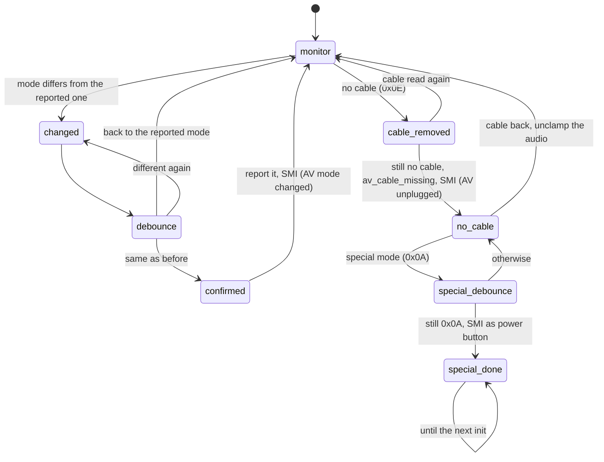

# Video mode (AV pack)

`src/smc_video.cpp`, PIC 0x851. Reads the AV pack ID pins and reports the
connected cable (SMBus 0x04). Mode pins read 0x0E (all high) without a cable;
0x0A while unplugged is a special mode that acts like the power button.

`SMC_AV_PACK_OVERRIDE=ON` replaces the pins with `SMC_AV_PACK_MODE`.

| # | State | What it does |
|---|-------|--------------|
| 0 | `monitor` | Watches the pins. Prints the cable once after power on |
| 1 | `changed` | Remembers the new reading |
| 2 | `debounce` | Reads again: the mode must be the same twice |
| 3 | `confirmed` | Reports the new mode and raises the AV mode changed SMI |
| 4 | `cable_removed` | Reads again and goes back to `monitor` unless it still reads no cable, then sets `av_cable_missing` (LEDs, audio clamp) and raises the AV unplugged SMI. This debounce comes from P2L (v1.6) and applies to every firmware: the PIC's version compares a value with itself, so it accepts the removal at once |
| 5 | `no_cable` | Waits for a cable or the special mode |
| 6 | `special_debounce` | Confirms the special mode |
| 7 | `special_done` | Stays until the state machine is re-initialised |
